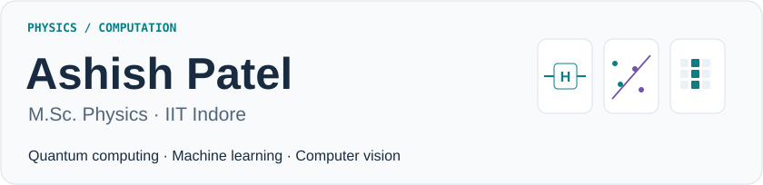

<picture>
  <source media="(max-width: 600px) and (prefers-color-scheme: dark)" srcset="assets/profile/header-compact-dark.svg">
  <source media="(max-width: 600px)" srcset="assets/profile/header-compact-light.svg">
  <source media="(prefers-color-scheme: dark)" srcset="assets/profile/header-dark.svg">
  
</picture>

I'm **Ashish Patel**, an **M.Sc. Physics student at IIT Indore**, exploring quantum computing, machine learning, and computer vision. My research experience spans cosmological inference and lead-free functional materials, alongside introductory practice with quantum gates and circuits. I'm looking for a research project where I can develop these interests through computation and careful experimentation.

[CV](https://drive.google.com/file/d/1OilklHdq4kDymTDC4mPz0Fq06UnjYSVQ/view?usp=sharing) · [Email](mailto:ashishpatel34520@gmail.com) · [LinkedIn](https://www.linkedin.com/in/ashish-patel-646521292) · [Research notebooks](https://github.com/asp123-cyber/DSKC/tree/main/Programs)

**Best Oral Presentation · RAFM-2026** &nbsp; / &nbsp; **JEST · AIR 218**

## Selected research

### Cosmological inference
**D. S. Kothari Centre · University of Delhi · Summer 2025**

As part of a four-student team, I worked on investigating extensions of ΛCDM using Pantheon Type Ia supernova distances. Our Python notebooks use ensemble MCMC to explore parameter estimates and posterior distributions for two choices of an additional cosmological component. The results depend on the adopted calibration and priors. This project gave me experience connecting a physical model to observational data and interpreting the assumptions behind a fit.

[Explore the analysis and posterior plots ↗](https://github.com/asp123-cyber/DSKC/tree/main/Programs)

### Lead-free piezoelectric ceramics
**DBT-STAR · University of Delhi**

I synthesized **NKLN–BT ceramics**, identified the perovskite phase using X-ray diffraction, and examined grain morphology by electron microscopy. This work introduced me to the connection between materials preparation, structure, and functional properties. My presentation received the **Best Oral Presentation Award at RAFM-2026**.

## What I'm exploring

### Quantum computing fundamentals

My [quantum study notebooks](https://github.com/asp123-cyber/Quantum_Computing_basic) cover qubits, measurement, and gates using local Qiskit simulations. I'm developing an understanding of how gates change a state and how measurement probabilities follow from its amplitudes. This new learning illustration follows an ideal **H → H → X** circuit, with no measurement between gates.

<picture>
  <source media="(max-width: 600px) and (prefers-color-scheme: dark)" srcset="assets/profile/quantum-compact-dark.svg">
  <source media="(max-width: 600px)" srcset="assets/profile/quantum-compact-light.svg">
  <source media="(prefers-color-scheme: dark)" srcset="assets/profile/quantum-dark.svg">
  
</picture>

[Follow the states and probabilities ↗](docs/LEARNING-NOTES.md#quantum-gates) · [Still image](assets/profile/quantum-still-light.svg)

### Machine learning & computer vision

My [ML foundations repository](https://github.com/asp123-cyber/machine-learning-foundations) includes regression, classification, clustering, and a [housing-price exercise with diagnostic plots](https://github.com/asp123-cyber/machine-learning-foundations/tree/main/09_project_housing_price_prediction). I'm interested in how representations affect learning; computer vision is a direction I want to explore further. This new illustration pairs **logistic regression on synthetic data** with a **fixed edge filter**, which demonstrates image processing rather than a trained neural network.

<picture>
  <source media="(max-width: 600px) and (prefers-color-scheme: dark)" srcset="assets/profile/ml-vision-compact-dark.svg">
  <source media="(max-width: 600px)" srcset="assets/profile/ml-vision-compact-light.svg">
  <source media="(prefers-color-scheme: dark)" srcset="assets/profile/ml-vision-dark.svg">
  
</picture>

[Read the model and filter explanation ↗](docs/LEARNING-NOTES.md#machine-learning-and-vision) · [Still image](assets/profile/ml-vision-still-light.svg)

## Methods & other work

**Computing practice:** Python, NumPy, SciPy, Matplotlib, Jupyter, and `emcee` in cosmology; introductory Qiskit simulations and scikit-learn pipelines in the study repositories.

**Experimental practice:** ceramic synthesis, X-ray diffraction, and examination of grain morphology.

- **[LOGOS](https://github.com/asp123-cyber/LOGOS)** — A React and TypeScript publishing app with an author workspace, article discovery, and bookmarks.
- **[Monte Carlo estimation of π](https://github.com/asp123-cyber/DSKC/blob/main/Programs/1.%20Pi%20estimation%20using%20Monte%20Carlo.ipynb)** — Numerical estimation and convergence in two and three dimensions. [Run in Colab ↗](https://colab.research.google.com/github/asp123-cyber/DSKC/blob/main/Programs/1.%20Pi%20estimation%20using%20Monte%20Carlo.ipynb)

<strong>Training & research presentation</strong>

- **Machine Learning Course & Summer Internship** — EngineerCore in association with Effervescence, IIIT Allahabad, June–July 2026.
- **Quantum Computing Familiarization Programme** — FQCI, IISc Bangalore.
- **Python4Physics** — University of California, Berkeley, 2025. Submitted a course report.
- **DSKC summer research poster** — Miranda House, University of Delhi, 2025.

<strong>Further learning · quantum-kernel demonstration</strong>

[One qubit, two classes](https://asp123-cyber.github.io/asp123-cyber/lab/) is an educational simulation comparing a one-qubit fidelity kernel with classical models. It is supplementary learning material, not a claim of original quantum-ML research. [Method and source ↗](lab/README.md)

<strong>GitHub activity</strong>

 

  
  

<picture>
  <source media="(prefers-color-scheme: dark)" srcset="assets/activity/snake-dark.svg">
  
</picture>

---

I'm interested in project opportunities in **quantum computing, machine learning, or computer vision**. [Get in touch ↗](mailto:ashishpatel34520@gmail.com)

