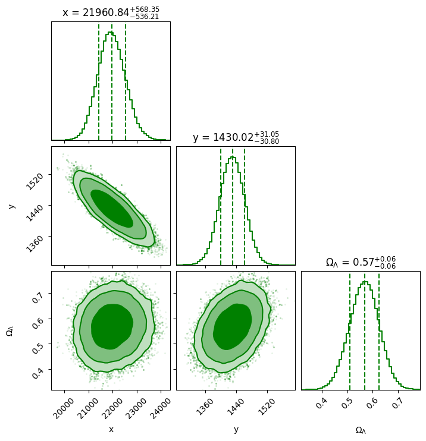
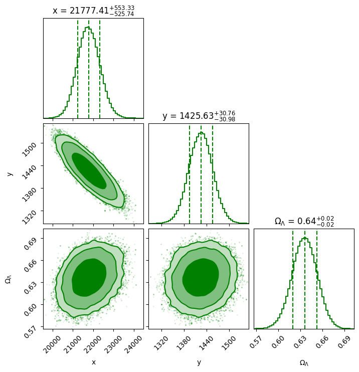

<picture>
  
</picture>

At the D. S. Kothari Centre, I used Python to model the expansion of the universe from Type Ia supernova distances. Our team compared two cosmological models using ensemble MCMC.  
At ARSD College, University of Delhi, I synthesized lead-free **NKLN–BT piezoelectric ceramics**, identified the perovskite phase by X-ray diffraction, and examined grain morphology by field-emission scanning electron microscopy (FESEM).  
I presented the ceramics results at **RAFM-2026**, where the work received the **Best Oral Presentation Award**.

## What do the Pantheon supernovae tell us about H₀?

Our [cosmology notebooks](https://github.com/asp123-cyber/DSKC) follow the supernova measurements from apparent magnitude to luminosity distance and then to a joint posterior. The two fits give similar median expansion rates, while the median density of the additional fluid changes sign.

<table>
<tr>
<td width="50%" valign="top"><strong>Case I · n = 1</strong> Fixed curvature Ωk = −0.053</td>
<td width="50%" valign="top"><strong>Case II · n = 2.5</strong> Fixed curvature Ωk = +0.132</td>
</tr>
<tr>
<td valign="top"></td>
<td valign="top"></td>
</tr>
<tr>
<td valign="top">H₀ = <strong>74.86</strong> (+0.26 / −0.26) km s⁻¹ Mpc⁻¹ Median extra-fluid density Ωₙ = +0.229 <a href="https://github.com/asp123-cyber/DSKC/blob/main/Programs/Paper%20K%20%5Bn%3D1%5D.ipynb">Read the Case I notebook ↗</a></td>
<td valign="top">H₀ = <strong>74.65</strong> (+0.23 / −0.24) km s⁻¹ Mpc⁻¹ Median extra-fluid density Ωₙ = −0.024 <a href="https://github.com/asp123-cyber/DSKC/blob/main/Programs/Paper%20K%5Bn%3D2.5%5D.ipynb">Read the Case II notebook ↗</a></td>
</tr>
</table>

The panels are saved outputs from our replication study. The sampled coordinates are (x = H₀²/Ωₘ), (y = H₀²Ωₘ), and ΩΛ. The quoted H₀ intervals span the 16th–84th percentiles under a fixed supernova absolute magnitude of −19.220 and a Gaussian prior on y. Both curvature and the fluid exponent differ between cases.

## Methods I use

**Scientific computing**  
   

**Statistical inference**  
  

**Experimental materials**  
  

<strong>Machine learning & selected workshops</strong>

- **Machine Learning Course & Summer Internship** · EngineerCore in association with Effervescence, IIIT Allahabad, June–July 2026.
- **Python4Physics** · University of California, Berkeley, 2025. Submitted a course report.
- **Advanced Semiconductor Materials & Devices Technology** · ANRF-CRT workshop, NIT Rourkela, 2026.

<strong>Presentations, postgraduate exams & outreach</strong>

- **RAFM-2026, ARSD College** · “Synthesis and Characterization of Lead-Free Piezoelectric NKLN-BT Ceramic.” Best Oral Presentation Award.
- **D. S. Kothari Centre, Miranda House, 2025** · Presented our supernova inference poster and submitted the team’s research report.
- **JEST** · All India Rank 218. Qualified IIT JAM Physics and joined the M.Sc. programme at IIT Indore.
- **Lunar Carnival 2025** · Led public engagement for the total lunar eclipse at the Prime Ministers’ Museum & Library and Nehru Planetarium.

<strong>GitHub activity</strong>

 

  
  

<picture>
  <source media="(prefers-color-scheme: dark)" srcset="assets/activity/snake-dark.svg">
  
</picture>

---

[Email](mailto:ashishpatel34520@gmail.com) · [LinkedIn](https://www.linkedin.com/in/ashish-patel-646521292)
