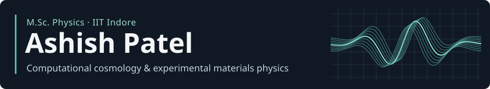

<picture>
  <source media="(max-width: 600px)" srcset="assets/research-header-compact.svg">
  <source media="(prefers-color-scheme: light)" srcset="assets/research-header-light.svg">
  
</picture>

I’m looking for a supervised M.Sc. project in **quantum computing or machine learning**. My background is in cosmological inference and experimental materials. I’m especially interested in how the way we encode data changes the patterns a model can learn.

## One qubit, two classes

A small interactive experiment in quantum machine learning. Change the rotation that encodes each input angle, then compare three classifiers on the same 48 held-out examples. Drag the probe to inspect the qubit state and its predicted class.

  
  &nbsp;&nbsp; <a href="https://github.com/asp123-cyber/asp123-cyber/tree/main/lab">Method &amp; source&nbsp;↗</a>

Why include a classical Fourier model?

The squared overlap of these one-qubit states can be calculated exactly using three ordinary Fourier features. The two implementations fit their weights independently and agree to numerical precision. On this synthetic task, switching from [one winding](https://asp123-cyber.github.io/asp123-cyber/lab/?w=1) to [two windings](https://asp123-cyber.github.io/asp123-cyber/lab/?w=2) changes the features available to both models.

## Selected research

**Cosmological inference · D. S. Kothari Centre**  
Our team used Python and ensemble MCMC to fit two extensions of ΛCDM to Pantheon Type Ia supernova distances. Both gave H₀ near 74.7 km s⁻¹ Mpc⁻¹ under the adopted calibration and priors. [Explore the notebooks and posterior plots ↗](https://github.com/asp123-cyber/DSKC/tree/main/Programs)

**Lead-free piezoelectric ceramics · DBT-STAR, University of Delhi**  
I synthesized NKLN–BT ceramics, identified the perovskite phase with X-ray diffraction, and examined grain morphology by electron microscopy. My presentation of this work received the **Best Oral Presentation Award at RAFM-2026**.

<strong>Software &amp; other notebooks</strong>

- **[LOGOS](https://github.com/asp123-cyber/LOGOS)** · A React and TypeScript publishing app with an author workspace, article discovery, and bookmarks.
- **[Monte Carlo estimation of π](https://github.com/asp123-cyber/DSKC/blob/main/Programs/1.%20Pi%20estimation%20using%20Monte%20Carlo.ipynb)** · Estimate π in two and three dimensions and inspect convergence as the sample grows. [Run in Colab ↗](https://colab.research.google.com/github/asp123-cyber/DSKC/blob/main/Programs/1.%20Pi%20estimation%20using%20Monte%20Carlo.ipynb)

<strong>Training &amp; distinctions</strong>

- **Machine Learning Course & Summer Internship** · EngineerCore in association with Effervescence, IIIT Allahabad, June–July 2026.
- **Quantum Computing Familiarization Programme** · FQCI, IISc Bangalore.
- **Python4Physics** · University of California, Berkeley, 2025. Submitted a course report.
- **JEST** · All India Rank 218.
- **DSKC summer research poster** · Miranda House, University of Delhi, 2025.

<strong>GitHub activity</strong>

 

  
  

<picture>
  <source media="(prefers-color-scheme: dark)" srcset="assets/activity/snake-dark.svg">
  
</picture>

---

[CV]().　[Email](mailto:ashishpatel34520@gmail.com)　·　[LinkedIn](https://www.linkedin.com/in/ashish-patel-646521292)
