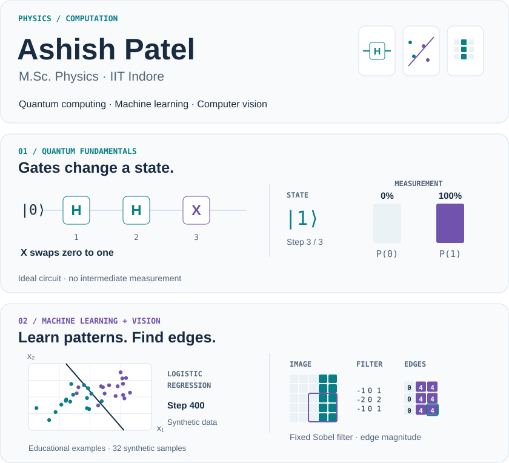

# Profile design and maintenance

The profile leads with identity, contact links, the presentation award, and JEST rank, then describes completed research before current learning. Quantum fundamentals and machine learning/computer vision receive matched illustration sizes and parallel descriptions. Course participation, learning examples, and completed research remain distinct.

The design draws on the concise identity and prominent project links of [Karpathy](https://github.com/karpathy) and [Raschka](https://github.com/rasbt), and the visible evidence of ongoing work on [Willison's profile](https://github.com/simonw). The visuals and wording are original to this profile. References were reviewed on 21 November 2026.

## Recommended pinned repositories

| Order | Existing repository | Reason |
| ---: | --- | --- |
| 1 | [DSKC](https://github.com/asp123-cyber/DSKC) | Completed team research with analysis notebooks. |
| 2 | [machine-learning-foundations](https://github.com/asp123-cyber/machine-learning-foundations) | ML study implementations and the housing-price exercise. |
| 3 | [Quantum_Computing_basic](https://github.com/asp123-cyber/Quantum_Computing_basic) | Introductory quantum-gate and circuit practice. |
| 4 | [LOGOS](https://github.com/asp123-cyber/LOGOS) | Supporting software-development work. |

This is a recommendation; editing the README does not change GitHub's native pinned-repository settings. The profile repository itself already supplies the profile introduction.

## Files

- `README.md`: public profile copy, links, and GitHub-compatible picture elements.
- `assets/profile/`: header and scientific illustrations. Each has light/dark and desktop/compact variants; the scientific illustrations also have still versions.
- `scripts/build_profile_assets.py`: editable geometry, palettes, mathematical examples, and numerical checks. No third-party Python packages are required.
- `scripts/render_profile_previews.cjs`: optional raster previews, using Node.js and `sharp`.
- `docs/LEARNING-NOTES.md`: explanations, assumptions, and questions to work through.
- `docs/previews/`: raster contact sheets of the actual generated artwork, not screenshots of GitHub's full interface.

## Preview the visual system

[Published GitHub README preview](previews/profile-live.jpg) — captured from the public profile after the update. Animated illustrations may be captured at their initial frame.

[Desktop light](previews/visuals-light.png) · [Desktop dark](previews/visuals-dark.png) · [Compact light](previews/visuals-compact-light.png) · [Compact dark](previews/visuals-compact-dark.png)



## Regenerate assets

```bash
python3 scripts/build_profile_assets.py
```

For optional PNG contact sheets, install `sharp` in your local Node.js environment, then run:

```bash
node scripts/render_profile_previews.cjs
```

The renderer also supports the Codex primary runtime's dependency location when that environment variable is available. The core SVG generator is portable Python.

Desktop images have an 840-pixel viewBox width, and compact images use 400 pixels. The README selects compact assets at viewport widths of 600 pixels or less. The matched light and dark variants use high-contrast text. Labels remain text inside the SVG; essential identity, research, and contact details also appear in the README body and links.

Animation is entirely inside self-contained SVG images. It plays once and settles on a readable final frame. Reduced-motion CSS and separate still assets are provided. There is no JavaScript, external font request, image-service dependency, or interactive canvas in the README. The existing interactive lab stays at its established URL.

## Editing principles

Keep completed projects ahead of proposed directions. Add a skill only when supported by practical work. Preserve team attribution and exact organizer relationships in training entries. Keep claims about cosmological parameters tied to their calibration and priors. Describe educational examples as learning material and link to their actual source.

The existing activity workflow and artwork remain available in the collapsed GitHub activity block. New profile artwork is generated locally and does not add a recurring workflow.

GitHub rendering references: [Markdown and picture elements](https://docs.github.com/en/get-started/writing-on-github/getting-started-with-writing-and-formatting-on-github/basic-writing-and-formatting-syntax) · [markup sanitization](https://github.com/github/markup).

## Verification on 21 November 2026

- The 537-word README rendered on the public profile, with all three new images loaded successfully.
- The SVG animation was observed progressing to its final frame in the browser; computed styles confirmed the ten-second animation.
- All 21 local README image/file references resolved. SVG XML, matching disclosure/picture elements, and the generator's numerical checks passed.
- Light and dark text contrast met a 4.5:1 minimum for the artwork's main text colors. Desktop and 400-pixel compact artwork were visually inspected. Full mobile-device browser emulation was not performed.
- The existing interactive lab opened at its established URL.
